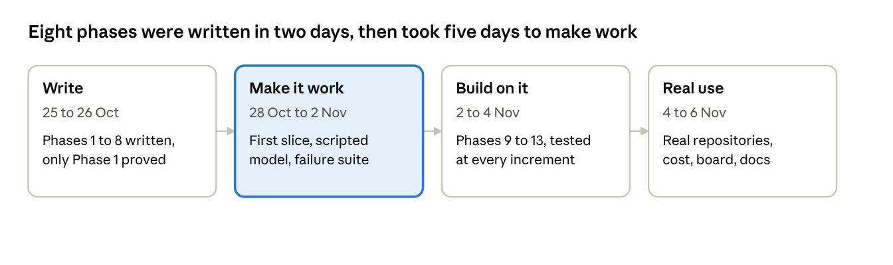
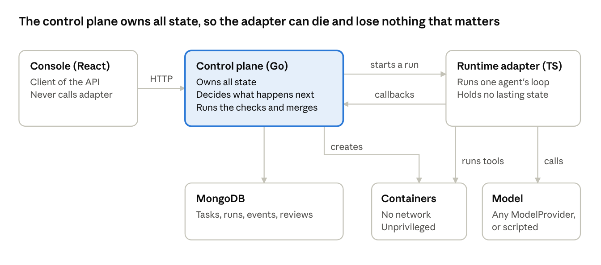
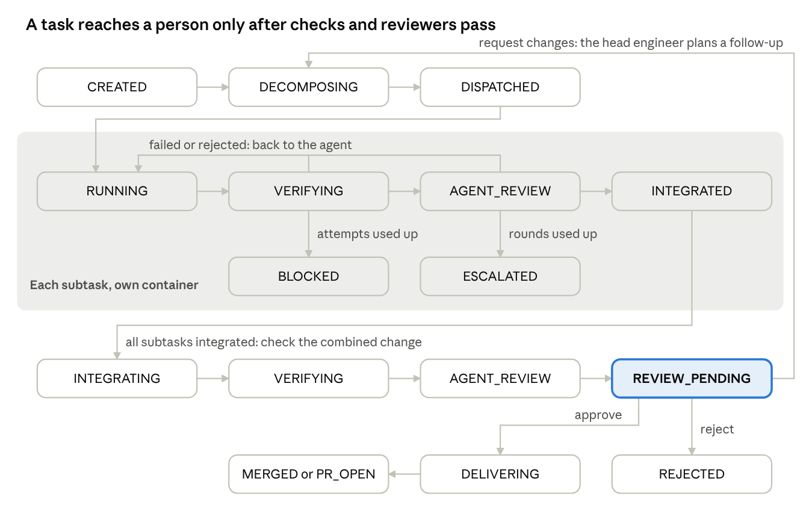

# Building a Harness: How We Built Forge, Phase by Phase

6 November 2026

## Preface

This book teaches you to build an agent harness by walking through one that exists, including the parts we got wrong. Forge took 57 commits and 13 days, from 25 October to 6 November 2026, and came to about 23,000 lines of Go and TypeScript.

Forge takes a requirement and its acceptance criteria. A team of AI agents does the work in Docker containers. The platform checks the result, other agents review it, and a person approves the merge.



The second stretch is the one most build stories leave out, and Part III is about it.

### Who it is for

It is for engineers who have made an LLM call a tool in a loop and now want to trust that loop with a real repository. You should be comfortable with git, Docker and HTTP services. You don't need Go or TypeScript to follow the decisions, though the code samples use both.

### What a harness is

A harness is everything around the model that makes its work safe to use. The model proposes. The harness holds the state, runs the commands in isolation, checks the claims, limits the spend and asks a person at the points that matter.

The model is the part you can't fully predict, so the harness has to behave correctly whatever the model does. Most of this book is about that one requirement.

### How to read it

The book runs in build order, because the order is part of the lesson. Each chapter gives the problem, the decision, the alternative we turned down where the record has one, and what happened when it met reality.

Three habits of the text are worth knowing:

- **Written and verified are different claims.** When we say something works, we say what proved it. Chapter 10 explains why this matters so much.
- **Quoted code is from the final build,** unless a chapter says otherwise. File paths are relative to the repository root, and `controlplane/` is short for `services/control-plane/internal/controlplane/`.
- **Where the record is silent, we say so.** Phases 9 to 13 have written plans with their decisions and alternatives. Phases 1 to 8 have no surviving plans, so those chapters are rebuilt from commits, decision records, the runbook and a review written at Phase 8. Reasoning we inferred afterwards is marked as such.

### What this book doesn't claim

Forge is verified by its test suites and by a small number of real-model runs on small tasks. It has not had long use by a team, and its known gaps are listed in the epilogue. Read it as a careful build log, not as proof of a production track record.

## Part I: The shape of the system

The decisions in this part were made before there was much code, and they are the ones that lasted. Almost everything later was added without having to undo them.

### Chapter 1: The control plane owns the truth

One rule shaped Forge more than any other: **the control plane owns the truth, and agents only propose.** An agent can say it fixed the bug. That sentence changes nothing until the platform has run the tests itself.

The vision behind the project was stated early and is worth quoting:

> "Agents with job descriptions, skills, etc. Organize work, supervise and review each other. Head engineer splits into specialized task. Within SDLC. Console for approval/feedback."

It is easy to read that as a prompt-writing problem. It is really a distributed-systems problem with an unreliable, expensive, occasionally wrong worker. That worker may stop mid-step, report success it did not achieve, or edit a file it was told to leave alone. So four things must stay out of the model's hands:

| The harness keeps | Because a model can't be trusted to | Where Forge does it |
| --- | --- | --- |
| State | Remember what happened after a crash | MongoDB and the state machine |
| Execution | Stay away from your SSH keys | Network-less, unprivileged containers |
| Judgement of results | Mark its own homework | Verification gates and separate reviewers |
| Limits | Stop spending | Step, wall-clock, token and cost caps |

A useful test for any design choice follows from this. Ask what happens if the model behaves as badly as it is able to. If the answer involves the model choosing to be sensible, the harness is not finished.

### Chapter 2: Three services and a boring stack

Forge is three services with one-way knowledge of each other.

- **The control plane** (Go, MongoDB) owns all state and decides what happens next. It creates containers and branches, runs the checks and merges.
- **The runtime adapter** (TypeScript) holds no lasting state. It runs one agent's loop: call the model, run the tool calls in the container, repeat. It reports heartbeats, checkpoints and completion back.
- **The console** (React) is a client of the control plane's API. It never talks to the adapter.



The arrows between the control plane and the adapter are protected from Phase 13 onward by a shared secret one way and a per-run token the other.

Decision record DR-0000 closed these choices on 25 October, with Ollama for local model serving. The record gives the choices and a revisit trigger, but not the reasoning:

> "Revisit trigger: polyglot maintenance cost > benefit → collapse to TS monorepo."

That trigger is the lesson worth copying. A decision with a stated condition for undoing it is much easier to live with than one that has to be defended forever. Two languages is a real cost, and we wrote down when it would stop being worth paying.

The reasoning below is ours, in hindsight. The split has held because the two halves change for different reasons. Orchestration changes when the pipeline changes. The agent loop changes when model APIs do. Keeping the adapter stateless also means it can die at any moment and lose nothing that matters, a property Chapter 12 tests by killing it on purpose.

### Chapter 3: Phase 1, the model contract and the smoke test

Phase 1 asked one question before anything else was built: can this model drive tools reliably?

The answer is a seven-check script, `make smoke`, against a `ModelProvider` contract:

```
PASS  healthCheck — reachable
PASS  listModels contains MODEL_NAME — N models
PASS  single-turn code gen — wall 3421ms
PASS  single tool call valid — read_file({"path":"greet.ts"})
PASS  multi-step tool use — final wall 5102ms
PASS  structured output valid — {"name":"forge","version":1}
PASS  tool-call validity ≥ 90% — 5/5

7/7 checks passed on model: qwen3-coder:30b
```

The last check is the one to steal. A model that writes good code but calls tools badly is useless in a loop. Below 90% valid tool calls, the runbook's advice is to change the model or the hardware, not to write a cleverer loop.

#### One contract, and three decisions about it

The contract began as the OpenAI-compatible `/v1/chat/completions` shape. That gave two providers on day one, Ollama and OpenAI, with a third compatible provider estimated at about 15 lines. The record then makes three decisions that matter more than the wire format:

1. **Provider choice is a security decision.** The record is blunt that `MODEL_PROVIDER=openai` sends prompts, file contents and diffs to OpenAI. So the allow-list `FORGE_ALLOWED_PROVIDERS` defaults to local only, and a cloud provider is opt-in.
2. **No silent fallback.** A provider failure surfaces as an error. A harness that quietly switches to another model on failure has also quietly changed where your code goes, what it costs and how good the output is.
3. **The abstraction bends when reality disagrees.** On 1 November Claude arrived as a third provider. It is not OpenAI wire-compatible: it has its own endpoint and headers, a top-level `system` parameter and `tool_use` content blocks. So `ClaudeProvider` implements `ModelProvider` directly instead of extending the OpenAI base. The contract stayed unchanged, and only the shared base class was skipped.

The local-first start also shaped what came later. Forge was first driven by a model running on the developer's own machine, and moved to a paid API later. Chapter 12 returns to this: once every test run costs money, you need a way to test without a model at all.

## Part II: Writing the pipeline (phases 2 to 8)

Seven phases were committed in two days, 25 and 26 October, and between them they sketch the whole product. Read this part as the design. Part III shows what happened when it first ran.

### Chapter 4: Phase 2, one agent in one container

Phase 2 proved the smallest useful thing: an agent fixes a real bug without being able to touch the host.

The test bed is a tiny fixture with an off-by-one bug in a pagination function. It stayed in use to the end of the project, because a small bug with a known answer tells you at once whether the machinery works.

#### The loop

The loop itself is short, and `services/runtime-adapter/src/agent.ts` still has that shape: send the messages, run any tool calls, append the results, checkpoint, repeat. It ends when the model stops calling tools or calls its submission tool, or when a limit is reached. All the difficulty lies in what surrounds it.

The tool list is deliberately small: `read_file`, `list_dir`, `search`, `write_file`, `apply_patch`, `run_command`, `git_diff` and `git_status`. Each runs inside the container and has to stay inside the workspace. If the model asks for a path outside it, the tool refuses with "path escapes workspace" and the model is expected to recover.

#### Why Docker is not optional

The early notes put the distinction well: the model is the brain, and Docker runs the hands. An agent's reasoning can happen anywhere, but its actions need a boundary.

- **On the host,** an agent that runs `rm -rf ~` succeeds.
- **In a git worktree alone,** it is still a process on your machine. Worktrees isolate directories, not processes, so it can still read your SSH keys.
- **In a container** with `--network=none`, only the workspace mounted, and `--memory=2g --pids-limit=256`, it has nothing to reach.

So Docker became a hard requirement whichever model is used. Phase 2 also fixed a principle for the rest of the build: the repository on disk stays unmodified during a run. The agent's output is a diff, and the harness decides what to do with it.

### Chapter 5: Phase 3, a state machine before anything needs it

Phase 3 added the control plane, MongoDB and the state machine, and made the machine the only way a task's status can change. The Phase 8 review later called this "cheap to add, impossible to retrofit", and we agree.

The table of legal moves is plain data in `controlplane/statemachine/task.go`:

```go
var taskTransitions = map[domain.TaskStatus][]domain.TaskStatus{
	domain.StatusCreated: {
		domain.StatusDecomposing, // head engineer dispatch (Phase 8)
		domain.StatusPlanned,     // direct dispatch (backward compat)
		domain.StatusDispatched,  // child claimed by the scheduler (Phase 8)
		domain.StatusBlocked,     // dispatch failed before the child was claimed
		domain.StatusRejected,
	},
	// ...
	domain.StatusResumable: {domain.StatusRunning},
	// Integrated, Rejected, RolledBack terminal
}
```

Every status change goes through one function, which checks the table and then writes with compare-and-set:

```go
func (s *Service) Transition(ctx context.Context, task *domain.Task, to domain.TaskStatus, reason string) error {
	if !CanTransition(task.Status, to) {
		return ErrInvalidTransition
	}
	from := task.Status
	at := time.Now().UTC()
	ok, err := s.Tasks.CompareAndSetStatus(ctx, task.ID, from, to, at)
	if err != nil {
		return err
	}
	if !ok {
		return ErrStaleTransition
	}
```

This gives you an audit trail, an event for each move, and a single place to read what can happen next. The compare-and-set part arrived only on 2 November, after a real bug (Chapter 11). It is what stops a heartbeat timeout and a late completion from both winning.

#### Resume is a design input

The other big idea in Phase 3 is that any run can die. The adapter saves a checkpoint after each step: the conversation and the workspace diff. A watcher marks a run `RESUMABLE` when its heartbeats stop for `STALE_AFTER`. Resuming builds a new container from the checkpoint and carries on.

As Part III shows, the first version of resume was close but wrong. The design survived anyway, because the checkpoint held what a new container needed.

#### A first lesson in stuck states

An early attempt to run a task exposed the classic state-machine bug. The dispatch code moved the task to `DECOMPOSING`, then tried to start a container while Docker was down. The handler returned a 500 but never moved the task on, so it sat in `DECOMPOSING` forever with no legal way out.

The rule to take from this: **after any status change, every failure path must also end in a status a person can act on.** Forge spent the rest of its life finding new versions of this bug, and Chapter 21 is the last of them.

### Chapter 6: Phase 4, verification the agent can't talk its way past

Phase 4 added gates that the platform runs after an agent finishes, whatever the agent says it did. They record their evidence in a `verificationRuns` collection, and they run in order:

| Gate | What it checks | Why it exists |
| --- | --- | --- |
| `secrets` | Added lines don't match key or private-key patterns | An agent may paste a credential into code |
| `diff-scope` | Changed files stay within the subtask's allowed patterns | Keeps parallel work apart, and agents on task |
| `build` | The project builds | A cheap failure before a slow one |
| `test` | The project's tests pass | The acceptance evidence |

A failed gate goes back to the agent with the output, up to `MAX_VERIFICATION_ATTEMPTS`, and then the task is `BLOCKED`. Feeding the real output back is what makes retries useful, because the agent can read the actual failure.

The gates are small shell scripts, and that makes them easy to get subtly wrong. The diff-scope gate went 11 days letting the shell expand `dir/**`, so legitimate files in subfolders failed it. It was fixed on 5 November, once a real repository had subfolders. Treat your checks as code that needs tests against realistic input.

### Chapter 7: Phases 5 and 6, a reviewer, a console and evals

Phase 5 separated the worker from the judge. A reviewer agent has read-only tools and must finish by calling `submit_review` with a verdict and defects. A rejection goes back to the implementer. A planner role arrived at the same time.

Two things about this phase turned out to be informative:

- **Roles were hardcoded in TypeScript.** It worked, but every new role meant new code. That pressure produced Phase 7.
- **The planner has never been verified with a real model.** It exists behind `PLANNER_ENABLED` to this day. We keep it listed as a known gap instead of quietly implying it works.

Phase 6 added the React console, a separate `approvals` collection for human decisions, and an eval suite with its own runner and a first case. The commit is honestly titled "phase 6 - console -> redefine".

Both parts then sat unused for a long time. The console's approval flow first ran on 2 November, during Phase 9.4. The eval suite did not run again until 5 November, when we found its runner pointed at the wrong port and model, and it passed anything that reached review (Chapter 19 has the fix). Code that nobody runs decays quickly, even in a project two weeks old.

### Chapter 8: Phase 7, agents as data

Phase 7 set out to make a new agent a markdown file and a reload, with no Go edits, no TypeScript edits and no rebuild. An agent's frontmatter holds its contract and the body holds its system prompt:

```yaml
---
name: head-engineer
description: Decomposes a software requirement into a dependency-ordered graph of specialized subtasks.
version: 1
model_preference: strong
submission_tool: submit_task_graph
skills:
  - generic-coding
  - decomposition-discipline
tools:
  - read_file
  - list_dir
  - search
  - git_status
  - git_diff
reviewers:
  - reviewer
  - security-reviewer
---
```

The key engineering move is one function that turns a definition into what the model sees. `Compose` in `controlplane/agent/compose.go` says so in its comment: "This is the single place where 'agent definition' becomes 'what the model sees'." It validates the tools and skills, then appends each skill to the prompt under a heading.

The payoff arrived one phase later. Adding the head engineer took a markdown file and orchestration code in the control plane, and only 13 changed lines in the adapter.

There is a sharp edge in this design: every `.md` file in `agents/` or `skills/` is loaded as a definition, and a bad one makes the registry fail at startup. Failing loudly is the right behaviour for a config error. It also means you can't drop a README in those folders, and the project's rules say so explicitly.

### Chapter 9: Phase 8, the head engineer and the task graph

Phase 8 is where a pipeline became a team. The head engineer writes no code. It reads the repository and submits a task graph, where each subtask names an agent, its dependencies and the files it may change (its `diffScope`).

Three pieces carry the phase:

- **The scheduler** starts each subtask whose dependencies have finished.
- **The integrator** applies each finished subtask to a parent branch.
- **Parent verification** runs the gates and a final review on the combined change, because two good subtasks can still be bad together.

Structured submission is the pattern to notice. The head engineer's output is a tool call with a schema, not prose to parse. The harness can reject an invalid graph as data, and it later rejects graphs with cycles or graphs that assign a reviewer to write code.

At the end of Phase 8, the code described the product we wanted. It had also just needed a round of compile fixes, and almost none of it had ever been run.

## Part III: Written is not verified

On 28 October, a review found that eight phases were written and only one had been confirmed working. The next five days added only one feature, the Claude provider, and went on making the rest work. If you take one part of this book to your own project, make it this one.

### Chapter 10: The milestone review

The review in `mile-stone-review.md` did something unusual: it separated what existed from what had been watched succeeding.

| Phase | Written | Verified on 28 October |
| --- | --- | --- |
| 1. Skeleton, adapter, smoke test | Yes | **Confirmed passing** |
| 2. Single-agent loop | Yes | Implied, never confirmed |
| 3. Control plane, state machine, resume | Yes | Connection error fixed, demo never confirmed |
| 4. Verification gates | Yes | Not run |
| 5. Planner and reviewer | Yes | Not run |
| 6. Console, evals, approvals | Yes | Not run |
| 7. Agent registry and skills | Yes | Not run |
| 8. Head engineer and integrator | Yes, just compiled | Not run |

Its verdict is the sentence this book is built around:

> "The distance between 'written' and 'verified' is the distance between a design document and a product."

It is easy to fall into this with AI-assisted development. Generated code compiles, reads well and looks complete, so a phase feels finished the moment it appears. The review also noted the warning sign we had been ignoring: Phase 8's compile errors suggested the code had drifted past what could be produced in one shot without feedback.

#### Test vertical slices, not phases

The review's recommendation went against the obvious plan. Testing phases one at a time would mean testing twenty things and still not knowing whether the pipeline worked. A single requirement needing two agents goes through the registry, composer, head engineer, scheduler, containers, gates, reviewer, integrator, parent verification and console.

One test touches eight phases, and if it fails at any step, you know which phase to open. That is the value of a vertical slice: it is the cheapest honest question you can ask a system.

### Chapter 11: The first slice, and what it found

The slice did not pass for five days. One bug made everything downstream unreachable. `CREATED → DISPATCHED` was not a legal transition, so the scheduler re-dispatched every child on every tick. Each re-dispatch destroyed the running agent's workspace and container, and the parent waited forever.

The commit that fixed it (`071c121`) on 2 November reads like a catalogue of harness bugs, and each one teaches something:

| What broke | Why | The fix | The general lesson |
| --- | --- | --- | --- |
| Two writers could both change a status | Status updates were unconditional | Compare-and-set | Timers and callbacks race, so make state changes atomic |
| `git` failed inside containers | A worktree's `.git` points at a path outside the container | A standalone clone per run | Also closes the agent's write path into your repository |
| Checkpoints went past Mongo's 16 MB limit | `node_modules` was captured in the diff | Exclude install output from diffs | Decide what counts as the agent's work |
| An agent that changed nothing counted as done | Completion trusted the agent | An unchanged workspace is `BLOCKED` | "Done" must be checked against evidence |
| Resumes were rejected by the model API | Checkpoints dropped the assistant's tool calls | Persist them | A saved conversation must be replayable |
| Reviewer turns overwrote the implementer's checkpoint | They shared a run | Keep them apart | Know whose state each write belongs to |
| The final review diffed nothing useful | The base was a moving branch name | Pin the base to a SHA | Comparisons need fixed points |

The clone is a decision worth pausing on, because it reverses Phase 2. Worktrees looked like the natural tool and had a real isolation flaw once containers needed git. Clones cost a little more disk and give you a repository with no write path back to the host. You will still see the old word in the code, where a variable named `worktreeDir` now holds a clone. A parent's integration branch does still use a real worktree on the host, and its combined checks and final review run in a container with that worktree mounted, so the no-write-path benefit applies to subtask runs.

#### Routing on data

Another flag from the review was closed the same day. Completion handling was a switch on a role string, the coupling the registry was meant to remove. It became a lookup on what the agent's own definition says it submits:

```go
var kindBySubmissionTool = map[string]completionKind{
	"submit_task_graph": kindDecompose,
	"submit_plan":       kindPlan,
	"submit_review":     kindReview,
}
```

No submission tool means a work agent. A new `security-reviewer` now routes correctly from its markdown alone.

A rerun then surfaced a planning failure: the head engineer assigned a child to the reviewer, which had no code to review, and that blocked the parent. Now the head engineer is offered only work agents, and a graph that assigns anyone else is rejected. Decide what a model may choose from before you ask it to choose.

### Chapter 12: A model that costs nothing

The slices proved the happy path, but failure paths are hard to reach with a real model. You can't ask Claude to fail verification exactly once. Paying for each attempt also makes you test less. So we built the piece we now consider the most valuable in the project: a scripted model provider.

It implements the same `ModelProvider` contract and replays canned turns from a JSON file, so everything else stays real: Docker, git, the gates, the reviewers, the integration.

```
{
  "head-engineer": [ Turn, ... ],
  "implementer":   [ Turn, ... ],
  "reviewer":      [ Turn, ... ]
}
```

A turn can include tool calls, a delay, token counts and a cut-off reply, so each failure a real model can produce can be written down and replayed exactly. Later, when work became parallel, turns could be keyed by prompt text so that concurrent agents each draw their own.

The harness in `scripts/phase8-failure-paths.sh` runs its own control plane and adapter on spare ports against a separate database. It started with four scenarios on 2 November:

| Scenario | What it forces |
| --- | --- |
| `verify-retry` | The first fix fails verification and the retry passes |
| `review-retry` | The reviewer rejects once and the rework passes |
| `exhaustion` | Verification keeps failing, so child and parent block |
| `crash-resume` | The adapter dies mid-run, the task goes `RESUMABLE`, then resumes |

The first run found three bugs in code that had looked fine:

- A single reviewer rejection blocked the task, because review rounds shared a counter with verification attempts.
- Resume started the agent with no tools, no submission tool and no composed prompt.
- Resume never recorded its new workspace, so verification and review used the dead container.

By the end of the build, `tests/failure-paths/` held 39 script files. The habit that grew from this was simple: a real bug gets a scenario, so it can't come back unseen.

#### The discipline this enabled

A scripted model also made a cost policy possible. Real-model runs moved to the end of each phase, and every increment in between was verified with unit tests and the harness. Phase 13's six increments were checked this way, then all five Claude slices ran once at the end for $0.09 by Forge's own pricing. The saving is the smaller benefit. The larger one is that you test constantly, because testing is free.

A scripted model can't tell you whether a real model will do good work. That is what the slices and evals are for, and you need both.

### Chapter 13: Cleaning up after yourself

Containers leaked whenever a task ended `BLOCKED`, `RESUMABLE` or `REVIEW_PENDING`, after crashes, and when an install outlived its timeout. Killing the docker CLI, it turns out, doesn't stop the container.

The answer was a reaper that sweeps at startup and every 30 seconds. It releases a run's container and workspace once its task leaves the active states, and it removes labelled containers that no active task owns. A 10-minute grace period protects provisioning that is still in flight.

The most important detail is its scope. Every container and directory carries a `forge.instance` label set to the database name, and a reaper touches only its own. Without that, the test harness's reaper would kill the real Forge's running agents. Any janitor in a system needs to know exactly what it owns.

#### Proving the central promise

The last step of this period ran the test the review had asked for: add an agent. The `add-agent` scenario writes `docs-writer.md` on a private copy of `agents/`, reloads, checks that the head engineer is offered it, watches a child run as `docs-writer@v1`, then deletes the file and confirms it is gone.

That was the Phase 7 exit criterion, and it had never been run. With it passing, Phase 8 was verified end to end, and new features could finally go on a base we trusted.

## Part IV: From a pipeline to a team (phases 9 and 10)

With a verified base, cross-review and parallel execution both landed on 2 November. They went fast because each increment ended with tests passing and a commit, and because the scripted suite caught regressions at no model cost.

### Chapter 14: Phase 9, cross-review and escalation

Phase 8 had a reviewer, but the review had called it what it was: single-reviewer supervision is a pipeline, and cross-review is what makes a team. The data model promised a `reviewers` list and the runtime read `reviewers[0]`. A data model that promises more than the runtime delivers is a bug waiting for a reader, so Phase 9's first job was to make the list true.

#### The four decisions

1. **Reviewers run one after another.** They shared the implementer's container, and the adapter's diff capture ran `git add -A` and `git reset` there on each checkpoint. Parallel reviewers would have raced on the git index. Sequential was enough to prove the idea, and parallelism was deferred to Phase 10 on purpose.
2. **Every reviewer runs each round, even after a rejection.** One round then yields all the defects, and the implementer fixes them together. Stopping at the first rejection would mean discovering them one paid round at a time.
3. **Repeated rejection escalates to a person.** This is a new `ESCALATED` state. Objective failures, such as verification exhausted or no change produced, still go to `BLOCKED`.
4. **Reviewers are review agents.** A reviewer is any agent with `submission_tool: submit_review`. The loader rejects a `reviewers` entry that is unknown, isn't a review agent, or is the agent itself.

The split in decision 3 deserves a closer look. `BLOCKED` means a fact stopped the work: fix the cause and continue. `ESCALATED` means judges disagree with the work, and only a person can settle that. The two look alike on a dashboard and call for different actions, so they got different states.

The outcome of a round became a pure function over its verdicts. All pass integrates the work. Any fail or error with rounds left re-invokes the implementer, with defects grouped by reviewer. Any fail or error with no rounds left escalates. A reviewer that can't run counts as an error, which rejects: an absent judge must not count as approval.

#### Timeouts need a single winner

A reviewer that never reports would leave a task in `AGENT_REVIEW` forever, so the watcher now settles it as an error after a timeout. That creates a race: what if the verdict arrives just as the timeout fires? A Mongo claim on the pending reviewer slot makes sure only one of them settles it.

The new scenarios also found a bug in the existing recovery logic. A run re-entering `RUNNING` kept its old heartbeat, so the watcher marked retries `RESUMABLE` while their workspace was still being provisioned.

#### What a real reviewer told us

Real-model runs earned their cost by finding things no script would. A Claude `test-reviewer` reported that it couldn't confirm "npm test passes", because reviewers have read-only tools and can't run the suite. It was right. Every reviewer prompt now includes the platform's verification results with the tail of each gate's output.

The principle is general: **a reviewer can only judge what you show it.** When an agent complains about its information, treat the complaint as a bug report on your harness.

### Chapter 15: Phase 10, parallel execution

Phase 10's goal had two halves: independent subtasks run at the same time, and the result must match what running them one after another would have produced.

Its plan opens with a table headed "read from the code, not assumed", and it turned up a surprise. Agents of independent children were already concurrent, because starting a run was fire-and-forget. The real bottleneck was provisioning, which happened serially inside the scheduler's 5-second tick, so one slow `npm install` stalled everything. And nothing capped concurrency, though each run is a 2 GB, 2 CPU container. Check where you actually stand before designing where to go.

#### The decisions

| Decision | Reason |
| --- | --- |
| `MAX_CONCURRENT_RUNS` defaults to 3 | Each run is expensive, so the limit is a deliberately low knob |
| Provisioning moves off the tick, into a new `PROVISIONING` status that the stale-run watcher ignores | The tick stays fast, and an install no longer looks like a dead agent |
| Integration is serialized per parent | Two siblings finishing together must not write to one worktree at once |
| Each run pins its base commit as a SHA | A branch name moves, and a diff needs a fixed base |
| Overlapping scopes are serialized, not rejected | Parallelism is earned by declaring disjoint scopes |
| Reviewers run in parallel, with diff capture off and `GIT_OPTIONAL_LOCKS=0` | Readers shouldn't take the index lock |
| One control plane per database | The lock is in-process, and a distributed one wasn't worth building yet |

The overlap rule is the design at its best. The head engineer doesn't have to be trusted about what can run together. If two tasks with no dependency between them have overlapping `diffScope`s, or either declares none, the harness adds an implicit dependency and records why in a `child.serialized` event. It is stored as `implicitDependsOn`, apart from the head engineer's `dependsOn`, so the console can show the difference between what the model asked for and what the platform imposed. Being safe is the default, and speed has to be declared.

#### A planned feature we removed

The plan called for one automatic rework when a subtask conflicted at integration. While building overlap serialization, we noticed it could never fire. Parallel subtasks have disjoint scopes, and the diff-scope gate rejects changes outside them, so siblings never touch the same file.

We dropped the rework and wrote down why, with a note to revisit if conflicts are ever seen. A conflict still resets the worktree and blocks with git's output. Don't build handling for a case your other rules make impossible, particularly if you couldn't test it end to end.

#### The bug only concurrency could find

Document IDs for events and approvals were the time in nanoseconds. When parallel subtasks transitioned in the same clock tick, the IDs collided. The duplicate event made `Transition` return an error even though the status had already changed, which blocked a healthy child.

IDs became UUIDs, and a transition no longer fails because its event couldn't be recorded. To gain confidence, the parallel scenarios ran three extra times each. Concurrency bugs often pass once.

#### Agents need to know their boundaries

The first Claude re-run of the pagination demo split the work into a fix and a sibling subtask for tests. The test-reviewer, unaware that tests belonged to a sibling, rejected the fix for missing tests. The implementer, unaware of its scope, added them and then failed the diff-scope gate twice.

Both agents had behaved reasonably on the information they had. The fix was a "Scope of this subtask" section in the prompts, listing its files and its siblings, plus an instruction that reviewers must not fail a subtask for a sibling's work. Two re-runs hit the same split and passed.

This is the commonest shape of agent failure we saw: a sensible decision made on missing context. Before tuning a prompt's wording, check what the agent was actually told.

#### The result

The parallel slice measured 178 seconds of wall time for 267 seconds of subtask work on three subtasks, two of them independent. That is 1.5x, with everything integrated and the branch passing its tests.

The plan's follow-ups recorded a limit of this design. Each child's test gate runs the whole suite, so if the base already has a failing test, an independent sibling fails for a bug that isn't its own. Serial execution had hidden this, because dependents started after the fix landed.

## Part V: Reaching the real world (phases 11 to 13)

Up to this point, Forge's output stopped at an approved branch and touched nothing shared. These three phases connect it to your repository, to people's judgement and to a network where others can reach it. Mistakes become more expensive here, so the designs get more defensive.

### Chapter 16: Phase 11, delivery

The goal of Phase 11 was stated as a set of promises: nothing reaches the target branch or a remote without approval, nothing delivered is rewritten, and a delivered change can be rolled back.

Before this phase, `POST /approve` moved a status and nothing else. `APPROVED → MERGED` existed in the table and was never used.

#### Real branches from the first moment

The parent branch is now created with the task, named from its description: `forge/<slug>-<id>`. Each subtask gets its own branch cut from it, and merges back with a merge commit. Parallel siblings therefore merge like any two branches, and a person can inspect the history with ordinary git.

This replaced the Phase 10 three-way diff apply the same day it was written. We were happy to do that, since merge commits are a better record and the old approach was cheap to remove. Integration still works from the recorded diff, so it survives a reclaimed workspace.

#### Approval means one of two things

| Repository | What approval does | What happens next |
| --- | --- | --- |
| Has a remote | Pushes, never forced, and opens a pull request with `gh` | A person merges on the forge, and a poller moves the task to `MERGED` or `REJECTED` |
| No remote | Merges into the target locally | The task is `MERGED` |

A click that may push to GitHub under your name should say so first. `GET /tasks/{id}/delivery` returns a preview with the mode, the remote, the branches and the logged-in `gh` account, along with a plain sentence describing the action. **Delivery uses the same function as the preview, so the hint and the action can't disagree.** That is a small trick worth reusing whenever an interface promises what an action will do.

#### Never touch a working tree someone is using

Local delivery is the riskiest code in the project, because it writes to a person's checkout. Three rules govern it:

- **Build the merge without a checkout,** using `merge-tree --write-tree` and `commit-tree`.
- **Move the branch with a compare-and-swap `update-ref`,** so a concurrent change makes it fail instead of being overwritten.
- **Refuse a target that is checked out with uncommitted changes.** A clean checkout is fast-forwarded.

If the target has moved since the work began, delivery merges it in and **runs the gates again**. A clean textual merge doesn't prove the code still works.

Rollback follows the same philosophy: it reverts and never rewrites. Locally it lands a revert commit, and with a remote it opens a revert pull request. A failed rollback returns to `MERGED` with the reason, because the delivery still stands. A second rollback of something already reverted is refused rather than creating an empty commit.

#### Testing against GitHub without GitHub

The suite uses a stub `gh` that records its arguments and a local bare repository as `origin`. Remotes are identified by their configured URL, so `insteadOf` redirection keeps git traffic local while the code still thinks it is talking to GitHub. Real pull requests were checked once by hand on a private repository, and the runbook records that this is the extent of the coverage.

### Chapter 17: Phase 12, human feedback

Until Phase 12, a reviewer could only approve or reject, which is a poor way to say "nearly, but change this line". The goal was line comments, a third decision called Request changes, and answers from the agents.

#### Revisions and threads

A **revision** is the parent branch's tip each time the task reaches `REVIEW_PENDING`, numbered r1, r2 and so on. A thread anchors to a revision, a path, a side and a line, and it also stores the line's text and some surrounding context so it can be found again.

When a new revision is recorded, each open thread is followed through the diff. An unchanged line moves to its new number. A changed or removed line marks the thread *outdated*, keeping its last place and context. The plan is firm on this: anything uncertain is marked outdated rather than guessed. A comment silently attached to the wrong line is worse than one that admits it lost its place.

#### Sending work back

A combined change has no single author to send it back to. We considered reopening the subtask whose files a thread touches, and rejected it: it breaks down for threads spanning several subtasks or needing new work, and integrated children would have to be reopened.

Instead the head engineer runs again in follow-up mode, with the threads labelled T1, T2 and so on, plus the combined diff. It submits a follow-up graph, and new subtasks start from the parent branch's tip. The result returns as the next revision.

Two rules keep this honest:

- **Every open thread must be handled.** A subtask addresses it, or the head engineer answers it directly. A graph that leaves one out is refused, and the task returns to the person. A model can't ignore feedback by omission.
- **Agents reply, and only humans resolve.** An agent can mark a thread *addressed*, but only a person says it is done.

Follow-ups are capped by `MAX_REVISIONS` (default 3), since each one is a full and paid cycle.

#### A pattern worth noting

`reply_to_thread` is a no-op in the adapter. The tool call is simply recorded in the conversation, and once the subtask's work integrates, the control plane reads those calls and posts them as comments. If the work never integrates, the replies never appear, so an agent can't claim to have fixed something that was thrown away. It also means the agent never holds any write path to threads.

The final Claude slice ran the whole loop: a line comment asking for an exported `CENTS` constant, request changes, a follow-up subtask that made the change and replied, r2, resolve, approve, `MERGED`. The same flow then passed from the console.

### Chapter 18: Phase 13, hardening

At the start of Phase 13 anyone who could reach the port could approve and merge, and the adapter would run a model on your API key for anyone who asked. Its goal was that Forge could run on a machine others can reach, with no one able to drive it who shouldn't.

The plan opens with a table of today's exposure, and it is worth doing that exercise for your own system before reading what follows. The increments went from the outside in.

#### Service trust

Both services now bind to `127.0.0.1` by default. The adapter requires `FORGE_ADAPTER_TOKEN` and reports only to its configured control plane, ignoring any `callbackUrl` in the request. That last point closes a nasty hole: a request could otherwise have sent a run's results anywhere.

Each run's callbacks must present a token, an HMAC of the run ID under a control-plane key. Retries, resumes and reviewers of a run share it, and nothing per run has to be stored. Once a run is `COMPLETE`, callbacks are refused with a 409, so a forged or late completion can't push a diff into review.

#### People, roles and projects

| Area | Decision |
| --- | --- |
| Accounts | Local users with argon2id hashes. GitHub sign-in was left for later, because it needs a reachable callback and an OAuth app |
| Sessions | A cookie that is `HttpOnly` and `SameSite=Strict`, stored hashed, with a sliding 12-hour expiry and 7 days at most |
| Scripts | Personal `fgt_` API tokens, shown once, stored hashed, revocable |
| Roles | Viewer, member, reviewer, admin, per project |
| Tenancy | Projects within one deployment and database |
| Outsiders | 404 rather than 403, so IDs aren't confirmed to exist |

Three decisions here are worth more than the table:

- **Routes live in one table** (`api/routes.go`) naming who may call each, and a test walks it. An unprotected route can't be added by forgetting a line of middleware.
- **Actions are attributed from the session, not the request.** `reviewer` and `author` in a body are ignored. This also retired a Phase 12 check on agent names, because agents hold no user credentials at all. A rule that was once enforced by checking now holds by construction.
- **There is no "auth off" switch.** The harness and scripts run with authentication on, using a bootstrap token accepted only while no user exists. Test the configuration you ship.

#### The sandbox

This is the sandbox as it stands, from `controlplane/workspace/sandbox.go`:

```go
func sandboxArgs() []string {
	uid, gid := containerUser()
	return []string{
		"--user", fmt.Sprintf("%d:%d", uid, gid),
		"--cap-drop=ALL",
		"--security-opt=no-new-privileges",
		"--read-only",
		"--tmpfs", "/tmp:rw,exec,nosuid,size=1g",
		"-e", "HOME=/tmp",
```

The subtle threat was dependency installation. After the first subtask, the repository includes agent-written code, so an agent could add a `postinstall` script that would run *with network access* when the next workspace was set up. That would be an exfiltration path straight through the network isolation.

Setup was split in two: packages are fetched with network but no scripts, then scripts run with no network. The `sandbox-postinstall` scenario proves it from the attacker's side. A subtask plants a `postinstall` hook, and a listener on the host confirms it hears nothing, while the hook itself records a non-root uid, a read-only `/etc` and no DNS. A security control should be tested by trying to break it.

#### Spend caps

Caps were the last piece: tokens and cost, per task (shared with its subtasks) and per project. The adapter reports usage on each checkpoint, the control plane prices it, and over a cap the checkpoint's answer tells the adapter to stop before its next model call. No agent starts while a cap is reached.

Putting the cap check in the checkpoint reply means the control plane stays in charge while the adapter stays simple. It also means a stop happens only between model calls, which is the right granularity for a cost control.

The real-model pass at the end found a billing bug: each agent's final model call went uncounted. Other late fixes included a stale run's empty completion overwriting a good checkpoint, and a retried delivery skipping verification of a merge that had already failed it. Tasks left `DELIVERING` by a restart now resume safely too, proved by the `restart-mid-delivery` scenario using `kill -9`.

Here is the task's whole path as it stood at this point. The full set of legal moves is in `controlplane/statemachine/task.go`.



With that, all thirteen planned phases were done on 4 November. The next two days taught us that finishing the plan is not the same as finishing the work.

## Part VI: After the plan

All thirteen phases passed their exit checks on small fixtures, and then real repositories soon found new failures. None of the fixes in this part appeared on the original roadmap. Most came from a person running real tasks, hitting something, and reporting it.

### Chapter 19: What fixtures can't tell you

Our fixtures were small and tidy, and real projects aren't. Each problem below got past every test until real use found it:

| Reality | What had been happening | The fix |
| --- | --- | --- |
| The project sits in a subfolder like `app/` | Build and test gates were **skipped**, so changes could be approved with their tests never run | Find projects up to three folders down, each with its own package manager |
| A real suite takes minutes | Timeouts built for fixtures | Limits of 10 minutes for install and 15 for tests, and truncated output keeps the end, where failures are listed |
| A model reply takes longer than `STALE_AFTER` | Forge heard from agents only between steps, so a slow reply got its container removed mid-step | The adapter heartbeats every 5 seconds while a run is active |
| A long report hits the output limit | A cut-off reply counted as finishing, so tasks blocked with a blank reason | Drop the reply, don't run its tool calls, retry with double the room, then block and say so |
| An agent uses `search` | **It failed on every query**, because `git grep` took the query as a path | Literal queries, tested against a real repository |
| Patches have slightly wrong hunk counts | Each one cost the agent a step | `git apply --recount` |

The subfolder row is the one that should worry you. A skipped gate looks exactly like a passing one unless you check. If a check can't find anything to check, that needs to be visible, and the console and gate results now show a skip with its reason.

The `search` row is the embarrassing one: a core tool was broken for ten days, across many passing runs, because no scripted scenario ever called it. Real models presumably got by with the other tools, which is how a broken tool can stay hidden. Test your tools directly.

#### The eval suite, repaired

The evals had a worse problem than not running. They passed anything that reached review, so they measured nothing.

A case now states its own checks, which the agent never sees:

```json
"checks": {
  "commands": [
    "node -e \"const a=require('assert'),{taxFor:t}=require('./src/tax');a.equal(t(50,8),4);a.equal(t(19.99,7.5),1.5);a.equal(t(10,0),0)\"",
    "node --test"
  ],
  "onlyChanged": ["src/tax.js", "tests/tax.test.js"]
}
```

The `taxFor(10, 0)` check isn't in the acceptance criteria shown to the agent. That is deliberate: hidden checks catch work that satisfies the letter of the task only. To test the runner itself, the scripted suite's case 0004 includes a change that is wrong on purpose. It passes Forge's reviewers and is caught by the case's checks. An eval suite needs proof that it can fail.

Each case can spend $0.50 and a run $2. The suite has still been run only with the scripted model, so we can tell you the runner works, but not how good the agents are.

#### Installing packages once

Every task reinstalled its dependencies, which was slow and wasteful. Packages now install into a shared read-only Docker volume named after what determines them: the dependency files, the folder and the worker image. Read-only matters here, because an agent must not be able to change what other tasks run. A marker file written last means an install that failed part-way is never used.

#### Resume, again

Resume had the longest bug list in the project, and each entry was found by someone resuming something:

- A resume that failed left its run `PROVISIONING` for good, which refused every later resume.
- From the second resume on, retiring the old workspace removed the new container, because they shared a name.
- A workspace that couldn't be read looked "clean" and could replace a good checkpoint.
- A subtask stopped at its step limit couldn't continue, because resuming kept its count and it stopped again at once.

Recovery paths run rarely, so they stay wrong for a long time. Scenarios named `resume-twice` and `max-steps-resume` exist because "it resumes" turned out to need several separate proofs.

### Chapter 20: Cutting costs

An agent resends its whole conversation at every step, so token costs grow quickly with the length of a run. Prompt caching was therefore the largest available saving. Forge turned it on for Claude and prices cached tokens separately, because caps that ignore caching would stop tasks at the wrong moment.

The other changes in the same commit stop paying for attempts that can't succeed:

- **Rate limits are waited out** instead of being retried within seconds. Limits are per minute, so a quick retry just fails again. Waiting also doesn't use up `maxRetries`.
- **An agent sent back gets its steps again** on top of those it used, rather than stopping immediately.
- **`report_out_of_scope`** lets an agent name a criterion it can't meet in its scope. The first rejection then escalates, instead of repeating review rounds the agent could never pass.
- **Tests are skipped on the combined check** if a subtask already passed them on exactly this code.

The third is the most interesting. We gave the model a way to say "this can't be done from here", so that an impossible task costs one review round instead of several. The head engineer is also told not to write such criteria in the first place. Honest failure should be cheap and easy for the model to report.

Note what is missing here: we have no before-and-after figure for these changes. We know why each should help, and we haven't measured how much. If you build this, record your per-task cost from the start.

### Chapter 21: Always leave a person a way forward

Two user reports led to the final design rule. One was "I escalated and the task is still in verifying". The other was what to do when Claude credit runs out. Both showed the same thing: a harness that depends on a model at every step has no way forward when the model is the problem.

Accepting an escalation calls no model, so it became the route to the merge step when Claude can't be reached. The changes followed from that:

- A task that is blocked with work to accept, or whose checks are still running, can be escalated. **Skip the checks** in the console does this, and stopped checks discard their result.
- Credit and key errors raise `ModelRefusedError` and aren't retried, because retrying can't help and each attempt may look like progress.
- Reviewers that can't run say so.

Here is the final table of what stops a task, and the way out of each. Each row exists because someone was once stuck there.

| Situation | Status | Way forward |
| --- | --- | --- |
| A check or agent gave up | `BLOCKED` | Resume with more steps, or Escalate |
| Heartbeats stopped for `STALE_AFTER` | `RESUMABLE` | Resume from the last checkpoint |
| Reviewers keep rejecting, or a person stepped in | `ESCALATED` | A person accepts, sends back or rejects |
| Delivery failed | `BLOCKED` with a delivery error | Fix the cause, then Retry delivery |
| Spend cap reached | `BLOCKED` | Raise the cap, then resume |
| Model refuses calls | `BLOCKED`, not retried | Fix the key or credit, or Escalate and Accept |

This completes the rule from Chapter 5. Every state a task can stop in needs a visible reason and an action a person can take. Audit for this directly: list your non-terminal states and ask what a person would click in each.

### Chapter 22: A board for people

The console had grown phase by phase, so on 6 November it was rebuilt around how a person actually works: a Kanban board with Backlog, Todo, In progress, In review, Done and Closed.

The tempting design stores a column on each task and lets people drag cards. That creates a second source of truth, which can disagree with the state machine. Forge's board **derives the column from the task's status**, and stores a lane only for the two choices status can't express: Backlog or Todo before a task starts, and Done or Closed after it merges.

```ts
export function columnOf(t: Task): Column {
  // The head engineer has planned a subtask that hasn't started, so it's next up.
  if (t.status === "CREATED" && (t.parentId || t.boardLane === "todo")) return "todo";
  if (t.status === "MERGED" && t.boardLane === "closed") return "closed";
  return COLUMN_OF[t.status] ?? "progress";
}
```

This is the Chapter 1 rule again, applied to the interface: the control plane owns the truth, and the board is a view of it. The other decisions follow from that:

- **Only moves that do something can be made.** A column refuses a card it can't accept, and a subtask follows its parent.
- **Starting asks first,** because it spends money. The dialog names the model and the cap.
- **Approving stays on the task page.** It is a decision that should be made while looking at the change, so it isn't available by dragging a card.
- **"Needs you" is a filter,** because a person's main question is what is waiting for them.

Real mouse dragging is the one thing here we couldn't automate: our browser tool's drag didn't start a native drag, so we tested with dispatched drag events. A person should confirm it by hand.

### Chapter 23: Documentation for coming back

The final commit answers a practical question: if you close this project for six months, how quickly can you reopen it? The user's first idea was a doc file per folder explaining each file. We kept the per-folder part and gave up on covering every file, because exhaustive listings go stale fastest and repeat what the code says. The last section of the runbook, a Phase 1 to 3 file table now marked out of date, is the evidence.

Three layers replaced it:

| Layer | Holds | Read it |
| --- | --- | --- |
| `CLAUDE.md` | Layout, how to run it, rules, where to change things | First, always |
| `docs/ARCHITECTURE.md` | How a task travels from creation to merge | To understand a flow |
| A `README.md` in each code folder | Its job, where to start reading, its traps | When working there |

Plans and old reviews are kept but carry a history banner, so nobody mistakes them for the current design. The traps are the most valuable lines, because they hold what the code can't say. For example, a resume needs a new container name each time, or a second resume deletes its own container.

`make docs-check` keeps this honest. It fails if a code folder has no README, or if a doc names a file or make target that doesn't exist. It can't check whether a sentence is still true, and writing this book proved that. When this book was drafted, `docs/ARCHITECTURE.md` still said each run works in a git worktree, days after Chapter 11's change to clones. Our first correction was wrong too: it claimed agents never get the integration worktree, and the code showed that final reviewers' containers mount it. Automated checks catch dead references, and only a reader catches stale claims.

## Epilogue: what we would tell you

The hard part of a harness was never calling the model. It was everything that has to stay correct while the model does something unexpected, and most of that only showed up when we ran the system.

### Ten rules from this build

1. **The control plane owns the truth, and agents propose.** Agents can't change state directly, and their claims are checked. (Chapter 1)
2. **Written is not verified.** Keep the two apart in your own reporting, and say what proved each claim. (Chapter 10)
3. **Test vertical slices first.** One path through everything finds the bugs that matter. (Chapter 10)
4. **Build a scripted model early.** Free tests get run, and failures become reproducible. (Chapter 12)
5. **Every stop needs a reason and a way forward.** List your states and check each one. (Chapters 5 and 21)
6. **Assume two writers.** Timers and callbacks race, so use compare-and-set and single-winner claims. (Chapters 5, 11 and 14)
7. **When an agent fails, check its context before its prompt.** Most sensible-looking mistakes came from missing information. (Chapters 14 and 15)
8. **Make the safe thing the default, and make speed something you declare.** Overlapping work is serialized unless scopes prove otherwise. (Chapter 15)
9. **Test recovery and security from the attacker's or failure's side.** Kill the process, and plant the `postinstall`. (Chapters 12 and 18)
10. **Don't store what you can derive.** One source of truth holds from the database to the Kanban board. (Chapter 22)

### What we would do differently

This is hindsight, and it is our opinion:

- **Run a slice from Phase 2 onward.** Eight phases without feedback produced the five-day repair in Chapter 11. Building the scripted model in Phase 2 would likely have prevented most of it.
- **Record cost per task from the start.** We can't show what the savings in Chapter 20 were worth.
- **Use a real repository before declaring the plan finished.** The fixtures were too tidy, and the failures in Chapter 19 were waiting.
- **Write phase plans from Phase 1.** Phases 9 to 13 have plans we could read back. Phases 1 to 8 had to be reconstructed for this book, and some reasoning is lost.

### Known gaps

These are open as of 6 November 2026:

- The planner role has not been verified with a real model.
- Resuming a rollback interrupted by a restart isn't covered.
- The eval suite has run only with the scripted model, so agent quality on real work is unmeasured.
- Real GitHub pull requests were checked once by hand. The suite uses a stub `gh`.
- One control plane per database, because the integration lock is in-process.
- Each child's test gate runs the whole suite, so a base that is already failing fails independent siblings too.
- The per-project network opt-in for install scripts was planned and not built.
- Real mouse dragging on the board has not been tested by automation.
- The effect of the cost changes hasn't been measured.

## Appendix A: Phase by phase

| Phase | Built | Date committed | Proved by |
| --- | --- | --- | --- |
| 1 | Skeleton, model contract, smoke test | 25 Oct | `make smoke` |
| 2 | Single-agent loop in a container | 25 Oct | Later slices and scenarios |
| 3 | Control plane, state machine, resume | 25 Oct | `crash-resume` |
| 4 | Verification gates | 25 Oct | `verify-retry`, `exhaustion` |
| 5 | Planner and reviewer roles | 26 Oct | `split-verdict`. Planner unverified |
| 6 | Console, evals, approvals | 26 Oct | Console in Phase 9.4. Evals scripted only |
| 7 | Agent registry, skills, composer | 26 Oct | `add-agent` |
| 8 | Head engineer, task graph, integrator | 26 Oct, working 2 Nov | Claude slices and the scripted suite |
| 9 | Cross-review and escalation | 2 Nov | Review and escalation scenarios, Claude slices |
| 10 | Parallel execution | 2 Nov | Parallel scenarios, 1.5x on a Claude slice |
| 11 | Delivery and rollback | 2 to 3 Nov | `deliver-*`, `rollback-*`, a Claude slice, a manual GitHub check |
| 12 | Human feedback | 3 Nov | `feedback-*` scenarios, a Claude slice, the console |
| 13 | Hardening | 4 Nov | Sandbox, budget and restart scenarios, five Claude slices |

## Appendix B: Decision index

| Decision | Alternative or risk | Chapter |
| --- | --- | --- |
| Go control plane, TS adapter, with a revisit trigger | A TS monorepo | 2 |
| No silent provider fallback | Automatic failover | 3 |
| Clones per run | Git worktrees, as first built | 11 |
| Route completions on `submission_tool` | A switch on role strings | 11 |
| Scripted model through the real pipeline | Mocked pipeline stages | 12 |
| All reviewers run each round | Stop at the first rejection | 14 |
| `ESCALATED` apart from `BLOCKED` | One failure state | 14 |
| Serialize overlapping scopes | Reject the graph | 15 |
| No automatic rework on conflict | One rework, as planned | 15 |
| Merge commits for subtasks | Three-way diff apply | 16 |
| Compare-and-swap ref updates, no checkout | Merging in the user's checkout | 16 |
| Rollback by revert | Rewriting history | 16 |
| Follow-ups through the head engineer | Reopening subtasks | 17 |
| Outdated threads flagged, not guessed | Fuzzy re-anchoring | 17 |
| Local accounts first | Sign-in with GitHub | 18 |
| Attribution from the session | Names in request bodies | 18 |
| No "auth off" switch | A development bypass | 18 |
| Two-step install, scripts without network | Installing with network | 18 |
| Board column derived from status | A stored column per task | 22 |
| Docs by folder, with traps | A doc per file | 23 |

## Appendix C: Glossary

| Term | Meaning |
| --- | --- |
| Parent, subtask | A top-level task, and the pieces the head engineer split it into |
| Run | One attempt at a task by an agent |
| Checkpoint | The conversation and workspace diff saved after a step |
| Gate | One automated check in verification |
| Round | One pass of all the reviewers over a change |
| Revision | A version of the combined change put in front of a person |
| Thread | A person's comment on a line of a revision |
| Follow-up | A trip back to the head engineer after Request changes |
| Parent branch | The branch subtasks merge into |
| Target branch | Where the finished work is delivered |
| Slice | A real-model test run through the whole pipeline |
| Scripted model | A test provider that replays canned replies and costs nothing |

## Sources

Everything here comes from the Forge repository at commit `0913d3c`: the git history, `docs/plans/`, `docs/decisions/`, `docs/ARCHITECTURE.md`, `docs/operations/RUNBOOK.md`, `mile-stone-review.md`, `README-TEST-SERVER.md`, and the code itself.
